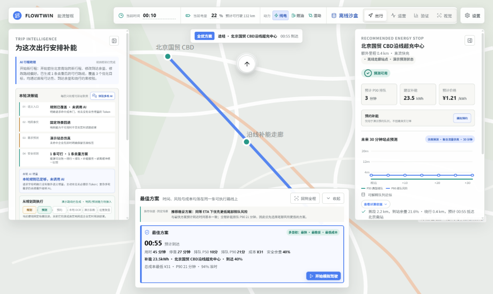
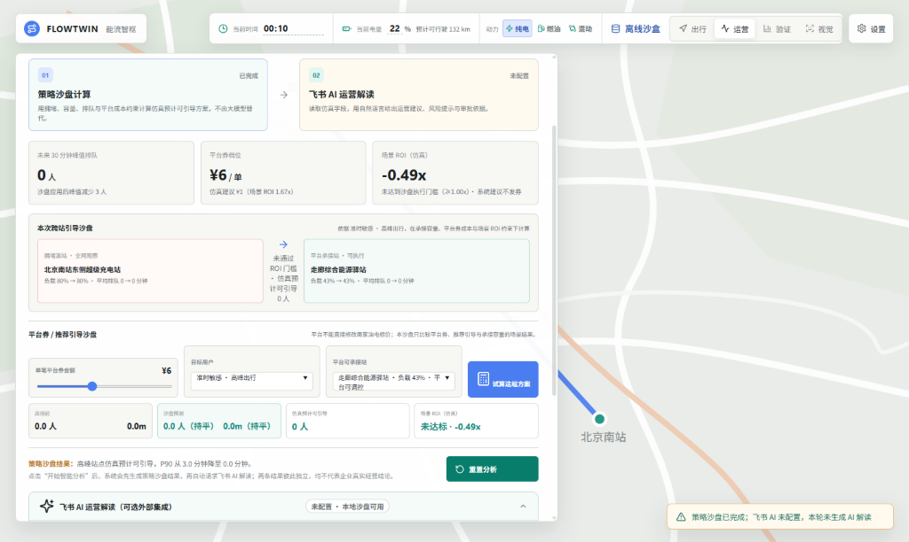
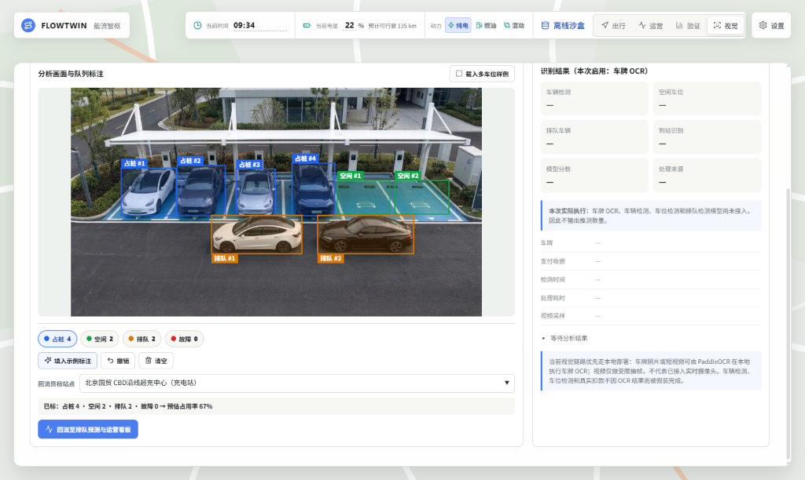

[简体中文](README.md) | English

<p align="center">
  
</p>

# FlowTwin

[](https://github.com/1Beyond1/flowtwin-demo/actions/workflows/ci.yml)
[](package.json)
[](LICENSE)

> **AI-Assisted Multi-Energy (EV + Fuel) Replenishment & Dispatch Workbench** — An end-to-end reference system connecting natural-language driver intent, multi-stop energy-safe routing, arrival-time P50/P90 queue simulation, operator load-balancing, and reproducible Monte Carlo validation.

---

## Interface Preview

### Driver View: Trip Intelligence

Parses natural-language trip requests into structured constraints and combines live routing (or the built-in offline corridor sandbox) with arrival-time P50/P90 queue forecasts to compare **Fastest**, **Most Reliable**, and **Lowest Cost** plans:



### Operator View: Pareto ROI Curve & Live Coupon Redemption Loop

Translates trip demand into station-side diversion strategies with an interactive **Pareto ROI sensitivity curve** (click any coupon tier to simulate), a live **issue → driver claim → receipt redeem** incentive loop, and optional Feishu Bitable AI approval sync:



### Vision View: Browser Canvas Queue Annotator → Port Forecast Feedback

Draw or auto-populate station bounding boxes (charging, idle, queued, fault) directly on sample or uploaded photos to trigger port-level discrete-event queue re-forecasting across Driver and Operator views, alongside optional local CPU PaddleOCR plate recognition:



### Mobile View: Responsive Layout

Adapts cleanly to 375–430 px mobile viewports with full powertrain/departure controls, natural-language intent input, structured constraints, and an independently scrollable multi-plan drawer:

<p align="center">
  
</p>

---

## Key Features

- **Zero-Key Offline Loop + Seamless Live Upgrade**: Works out of the box without any external API keys via a built-in gazetteer of 30+ major hubs, local rule-based intent parsing, local inline SVG icons, and an offline corridor sandbox covering routing, multi-stop planning, driving simulation, operator dispatch, and 1,000-trip validation. Automatically upgrades to live mode when AMap, OpenAI-compatible LLM, STT, or Feishu keys are configured.
- **Natural-Language Intent & Multi-Turn Refinement**: Extracts destination, arrival deadline/SOC margin, EV/fuel/hybrid powertrain, detour limit, priority, and corridor service stops, supporting multi-turn additions, edits, and browser native speech fallback when cloud STT is unconfigured.
- **Multi-Stop Long-Distance Replenishment**: Plans up to 6 stops on standard trips and up to 12 stops in adaptive extreme-distance mode, preferring AMap Route 2.0 ordered waypoints in live mode backed by layered server-side file caching (`runtime/cache/amap/`).
- **Arrival-Time Queue & Port-Level Simulation**: Predicts occupancy and P50/P90 waiting time at estimated arrival time using a unified stop-time ledger (`queue + service + payment/exit buffer`), running port-level discrete-event simulation with reservation queues alongside weather-aware pressure factors.
- **Departure Window Optimizer (`POST /api/departure-windows`)**: Evaluates 5 departure slots (`Now`, `+30m`, `+60m`, `+90m`, `+120m`) across arrival-time P50/P90 queue forecasts and 4-tier EV time-of-use tariffs (valley / flat / peak / super-peak), recommending the best off-peak shift with one-click replanning.
- **Multi-Vehicle Preset Library & Cost Ledger (`vehicle-presets.js`)**: Includes 8 built-in EV / fuel / hybrid presets plus custom vehicle profiles with fast-charge taper modeling; breaks down energy cost, highway tolls, diversion coupon savings, TOU savings, and cost/km with local ledger persistence and formula-injection-safe CSV export.
- **Operator Pareto ROI Curve & Live Coupon Loop (`/api/operator/simulate` · `/api/coupons/*`)**: Plots multi-tier coupon diversion and scenario ROI curves with a `1.0x` breakeven reference, issues live station coupons synced to Driver route cards and payment receipts, and feeds redemptions back into Operator KPIs; the Validation tab benchmarks four policies across 1,000 fixed-seed trips (`20260719`).
- **Browser Canvas Queue Annotator & Optional Integrations (`POST /api/vision/queue-feedback`)**: Annotate charging / idle / queue / fault slots directly on station images to update port-level discrete-event forecasts in real time; also supports Feishu Bitable AI readback, optional local CPU PaddleOCR (`cv-service/`), and private offline demand priors.

---

## Architecture

```text
Browser (Vanilla HTML/CSS/JS, zero build step, inline local icons, on-demand AMap loader)
  └─ Node.js Backend (zero third-party runtime dependencies)
      ├─ /api/health                       Health & dependency status booleans (no secrets)
      ├─ /api/contracts                    API route contract schema
      ├─ /api/plan                         Intent parsing (AI/local rules) + place resolution (AMap/offline gazetteer)
      ├─ /api/stt                          Optional speech-to-text proxy
      ├─ /api/route · /api/poi · /api/weather  Cached AMap driving, corridor POI & weather proxies
      ├─ /api/forecast                     Arrival-time queue simulation (port-level / aggregate)
      ├─ /api/departure-windows            5-slot off-peak departure & TOU tariff optimizer
      ├─ /api/longtrip                     Multi-stop long-distance replenishment planner
      ├─ /api/operator/simulate            Coupon pricing, Pareto ROI curve & diversion simulation
      ├─ /api/coupons · /api/coupons/*     Live diversion coupon issue, claim, redeem & reset loop
      ├─ /api/validate                     Reproducible 1,000-trip four-policy benchmark
      ├─ /api/vision/queue-feedback        Canvas queue annotation → port-level forecast feedback
      ├─ /api/cv/health · /api/cv/analyze  Optional local CPU PaddleOCR adapter
      ├─ /api/feishu/* · /api/execution    Optional Feishu Bitable AI sync & Webhook adapter
      └─ /api/version · /api/version/check Build metadata & manual GitHub release check
```

---

## Quick Start

### 1. Run Locally (Zero Dependencies)

Requires **Node.js 20+** (Node 22 LTS recommended):

```bash
npm start
```

Open <http://127.0.0.1:4182/> to use the full offline workbench immediately. To connect live AMap, OpenAI-compatible LLM, STT, or Feishu services, copy [`.env.example`](.env.example) to `.env` and fill in your credentials.

### 2. Run with Docker Compose

```bash
# Main service only
docker compose up --build

# Include optional local CPU PaddleOCR service
docker compose --profile cv up --build
```

---

## Testing

```bash
# Node.js syntax check & unit tests
npm run check
npm test

# Python CV adapter standard-library tests (no Paddle/OpenCV required)
python -m compileall -q cv-service
python -m unittest discover -s cv-service -p "test_*.py" -v
```

---

## Documentation

- [Architecture & Algorithms (ZH)](docs/architecture.md)
- [Deployment, Caching & Configuration (ZH)](docs/deployment.md)
- [Feishu Bitable AI Integration (ZH)](docs/feishu-integration.md)
- [Optional Local Vision Service (ZH)](docs/vision-service.md)
- [CV Service README](cv-service/README.md)

## License

Licensed under the [MIT License](LICENSE). Third-party mapping, model, and platform services are outside the scope of this license.
