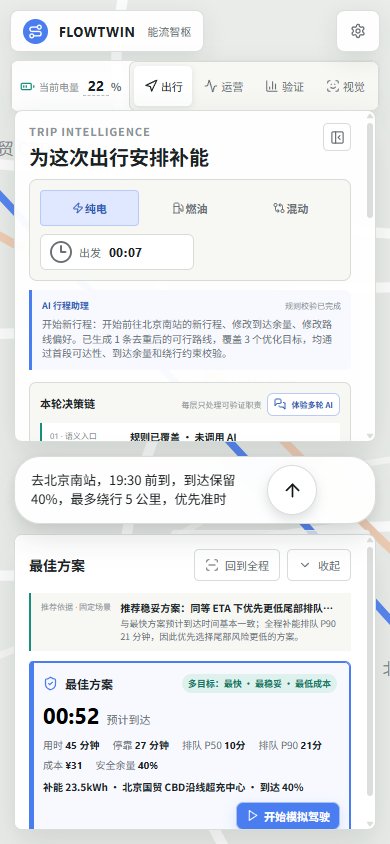

[简体中文](README.md) | English

# FlowTwin

[](https://github.com/1Beyond1/flowtwin-demo/actions/workflows/ci.yml)
[](package.json)
[](LICENSE)

> **AI-Assisted Multi-Energy (EV + Fuel) Replenishment & Dispatch Workbench** — An end-to-end reference system connecting natural-language driver intent, multi-stop energy-safe routing, arrival-time P50/P90 queue simulation, operator load-balancing, and reproducible Monte Carlo validation.

---

## Interface Preview

### Driver View: Trip Intelligence

Parses natural-language trip requests into structured constraints and combines live routing (or the built-in offline corridor sandbox) with arrival-time P50/P90 queue forecasts to compare **Fastest**, **Most Reliable**, and **Lowest Cost** plans:


### Operator View: Regional Supply-Demand & Strategy Console

Translates trip demand into station-side diversion and pricing strategies, comparing before/after queue times, diversion share, and scenario ROI with optional Feishu Bitable AI approval sync:


### Mobile View: Responsive Layout

Adapts cleanly to 375–430 px mobile viewports with full powertrain/departure controls, natural-language intent input, structured constraints, and an independently scrollable multi-plan drawer:

<p align="center">
  
</p>

---

## Key Features

- **Zero-Key Offline Loop + Seamless Live Upgrade**: Works out of the box without any external API keys via a built-in gazetteer of 30+ major hubs, local rule-based intent parsing, local inline SVG icons, and an offline corridor sandbox covering routing, multi-stop planning, driving simulation, operator dispatch, and 1,000-trip validation. Automatically upgrades to live mode when AMap, OpenAI-compatible LLM, STT, or Feishu keys are configured.
- **Natural-Language Intent & Multi-Turn Refinement**: Extracts destination, arrival deadline/SOC margin, EV/fuel/hybrid powertrain, detour limit, priority, and corridor service stops, supporting multi-turn additions, edits, and browser native speech fallback when cloud STT is unconfigured.
- **Multi-Stop Long-Distance Replenishment**: Plans up to 6 stops on standard trips and up to 12 stops in adaptive extreme-distance mode, preferring AMap Route 2.0 ordered waypoints in live mode backed by layered server-side file caching (`runtime/cache/amap/`).
- **Arrival-Time Queue & Port-Level Simulation**: Predicts occupancy and P50/P90 waiting time at estimated arrival time using a unified stop-time ledger (`queue + service + payment/exit buffer`), running port-level discrete-event simulation with reservation queues alongside weather-aware pressure factors.
- **Operator Load-Balancing & Reproducible 1,000-Trip Validation**: Models coupon pricing, target cohorts, capacity caps, diversion response, and scenario ROI; the Validation tab benchmarks four policies across 30 synthetic nodes and 1,000 fixed-seed trips (default `20260719`).
- **Optional Integrations**: Supports Feishu Bitable snapshot sync + AI field readback, an optional local CPU PaddleOCR adapter (`cv-service/`), and private offline demand priors (`runtime/enterprise-demand-prior.json`).

---

## Architecture

```text
Browser (Vanilla HTML/CSS/JS, zero build step, inline local icons, on-demand AMap loader)
  └─ Node.js Backend (zero third-party runtime dependencies)
      ├─ /api/health                       Health & dependency status booleans (no secrets)
      ├─ /api/contracts                    API route contract schema
      ├─ /api/plan                         Intent parsing (AI/local rules) + place resolution (AMap/offline gazetteer)
      ├─ /api/stt                          Optional speech-to-text proxy
      ├─ /api/route · /api/poi · /api/weather  Cached AMap driving, corridor POI & weather proxies
      ├─ /api/forecast                     Arrival-time queue simulation (port-level / aggregate)
      ├─ /api/longtrip                     Multi-stop long-distance replenishment planner
      ├─ /api/operator/simulate            Coupon pricing & traffic diversion simulation
      ├─ /api/validate                     Reproducible 1,000-trip four-policy benchmark
      ├─ /api/cv/health · /api/cv/analyze  Optional local CPU PaddleOCR adapter
      ├─ /api/feishu/* · /api/execution    Optional Feishu Bitable AI sync & Webhook adapter
      └─ /api/version · /api/version/check Build metadata & manual GitHub release check
```

---

## Quick Start

### 1. Run Locally (Zero Dependencies)

Requires **Node.js 20+** (Node 22 LTS recommended):

```bash
npm start
```

Open <http://127.0.0.1:4182/> to use the full offline workbench immediately. To connect live AMap, OpenAI-compatible LLM, STT, or Feishu services, copy [`.env.example`](.env.example) to `.env` and fill in your credentials.

### 2. Run with Docker Compose

```bash
# Main service only
docker compose up --build

# Include optional local CPU PaddleOCR service
docker compose --profile cv up --build
```

---

## Testing

```bash
# Node.js syntax check & unit tests
npm run check
npm test

# Python CV adapter standard-library tests (no Paddle/OpenCV required)
python -m compileall -q cv-service
python -m unittest discover -s cv-service -p "test_*.py" -v
```

---

## Documentation

- [Architecture & Algorithms (ZH)](docs/architecture.md)
- [Deployment, Caching & Configuration (ZH)](docs/deployment.md)
- [Feishu Bitable AI Integration (ZH)](docs/feishu-integration.md)
- [Optional Local Vision Service (ZH)](docs/vision-service.md)
- [CV Service README](cv-service/README.md)

## License

Licensed under the [MIT License](LICENSE). Third-party mapping, model, and platform services are outside the scope of this license.
