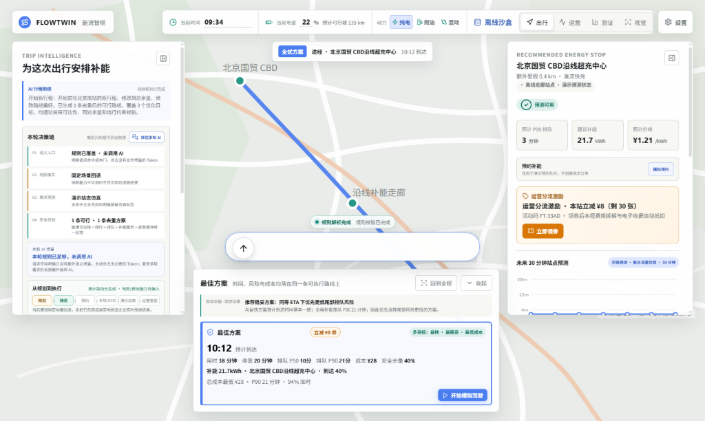
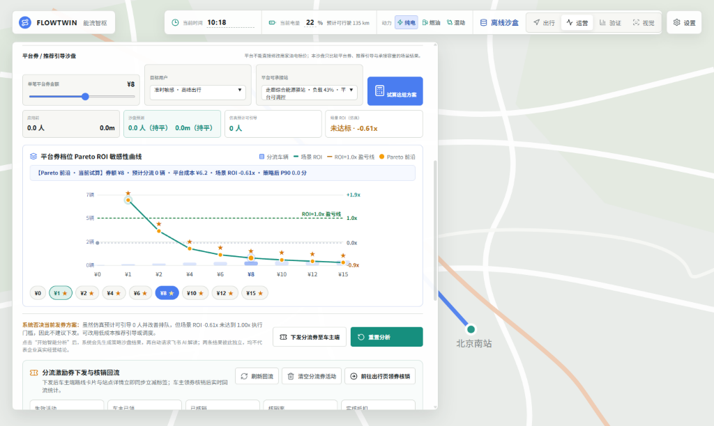
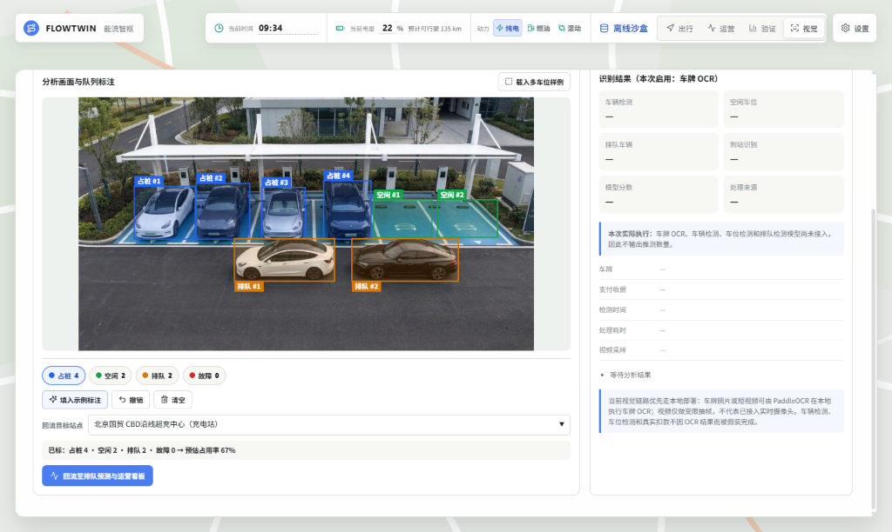
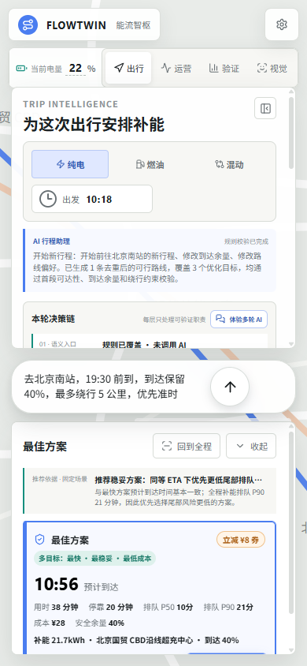

简体中文 | [English](README.en.md)

# 能流智枢 · FlowTwin

[](https://github.com/1Beyond1/flowtwin-demo/actions/workflows/ci.yml)
[](package.json)
[](LICENSE)

> **AI 油电一体化补能协同决策工作台** — 从车主自然语言行程需求出发，串联多站续航规划、到站时刻 P50/P90 排队仿真、多目标补能对比、运营分流调度与可复现蒙特卡洛验证的全栈参考实现。

---

## 界面预览

### 车主端：行程补能智算（Trip Intelligence）

自然语言意图解析为结构化约束，结合真实地图路由（或内置离线走廊沙盒）与到站时刻 P50/P90 排队预测，生成「最快到达 / 最稳妥 / 最低成本」多目标补能方案对比：



### 运营端：区域供需、Pareto ROI 曲线与分流券核销闭环（Operator Intelligence）

将出行需求转化为站点侧的引流与定价策略，提供多档平台券 **Pareto ROI 敏感性曲线**（支持点击档位即时试算）及 **下发分流券 → 车主端领券 → 结算核销回流** 实时闭环，并可选对接飞书多维表格 AI 审批：



### 视觉页：站内队列 Canvas 标注回流预测（Station Vision & Queue Annotator）

支持内置样例或实拍场站图的一键/框选标注（占桩、空闲、排队、故障），自动触发端口级离散事件仿真并回流至车主端排队预测与运营端供需池，同时可选接入本地 CPU PaddleOCR 进行车牌识别：



### 移动端：响应式适配（Mobile Responsive）

针对 375–430 px 手机视口自适应排布，完整保留动力切换、出发时间、自然语言输入、结构化约束与可独立滚动的多方案抽屉：

<p align="center">
  
</p>

---

## 核心特性

- **零密钥开箱可用（离线全链路 + 实况无缝升级）**：未配置外部 API Key 时自动启用内置 30+ 全国城市/枢纽离线坐标库、本地规则意图解析、本地内联 SVG 图标与离线走廊沙盒，车主规划、多站长途、模拟驾驶、运营调度与 1,000 次验证全链路可跑通；接入高德、OpenAI 兼容 LLM、语音转写与飞书后自动切换为实况模式。
- **自然语言意图解析与多轮规划**：支持中英文/中文自然语言解析目的地、到达时间/余量、油/电/混动动力类型、绕行上限、优先级与沿途餐饮/休息服务偏好，支持多轮追加停靠、修改约束与发起新行程；支持云端语音转写及浏览器原生语音识别降级。
- **长途连续补能与多途经点核验**：常规路线支持最多 6 站，极端长途自适应模式最多 12 站；联网模式优先调用高德路线 2.0 多途经点一次核验整条道路折线，服务端自带多级文件缓存（`runtime/cache/amap/`）。
- **到站时刻排队与端口级仿真**：按预计到站时刻计算站点占用率与 P50/P90 排队等待，采用统一停靠账本（`排队 + 补能服务时长 + 支付驶离缓冲`）；具备端口状态输入时启用端口级离散事件仿真并区分预约锁定与前置预约队列，同时融合实况天气因子动态修正排队压力。
- **错峰出发窗口优化器（`POST /api/departure-windows`）**：自动对比当前与未来 `+30 / +60 / +90 / +120` 分钟五个出发窗口的排队 P50/P90 与峰谷分时电价（谷时 / 平时 / 峰时 / 尖峰），给出最优错峰出发建议并支持一键切换重算。
- **多车型预设库与行程费用账本（`vehicle-presets.js`）**：内置 8 款纯电 / 燃油 / 插混主流车型预设并支持自定义保存与快充功率曲线核算；自动拆解补能费、高速过路费、分流券抵扣、峰谷价差节省与单公里成本，支持本地持久化记录与防公式注入 CSV 导出。
- **运营分流 Pareto ROI 曲线与领券核销闭环（`/api/operator/simulate` · `/api/coupons/*`）**：运营端基于合作站点容量与券窗口绘制多档优惠 Pareto ROI 敏感性曲线，支持一键向车主端下发分流激励券并实时追踪领券、结算核销与实核抵扣回流；验证页以固定随机种子（默认 `20260719`）对 30 个合成节点执行 1,000 次行程实验。
- **视觉页浏览器端队列标注回流与可选扩展（`POST /api/vision/queue-feedback`）**：在浏览器 Canvas 上框选占桩 / 空闲 / 排队 / 故障状态后自动调用端口级离散事件仿真更新车主端与运营端预测；同时支持飞书多维表格 AI 联动、可选本地 CPU PaddleOCR 服务（`cv-service/`）及私有离线需求先验加载。

---

## 系统架构

```text
浏览器（原生 HTML/CSS/JS，零构建、本地内联图标、按需加载高德 JS API）
  └─ Node.js 后端（零第三方运行时依赖）
      ├─ /api/health                       健康状态与外部依赖配置摘要（不返回密钥）
      ├─ /api/contracts                    API 路由契约说明
      ├─ /api/plan                         意图解析（AI/本地规则）+ 地点解析（高德/离线坐标库）
      ├─ /api/stt                          可选语音转写代理
      ├─ /api/route · /api/poi · /api/weather  高德路线、沿线 POI 与实况天气代理（带文件缓存）
      ├─ /api/forecast                     到站时刻排队仿真（端口级 / 聚合，支持天气因子）
      ├─ /api/departure-windows            5 窗口错峰出发与分时电价优化
      ├─ /api/longtrip                     多站连续补能组合规划
      ├─ /api/operator/simulate            优惠定价、Pareto ROI 曲线与分流仿真
      ├─ /api/coupons · /api/coupons/*     分流激励券下发、领券、核销与重置闭环
      ├─ /api/validate                     1,000 次固定种子策略对比实验
      ├─ /api/vision/queue-feedback        视觉页人工队列标注回流端口离散仿真
      ├─ /api/cv/health · /api/cv/analyze  可选本地 CPU PaddleOCR 适配器
      ├─ /api/feishu/* · /api/execution    可选飞书多维表格 AI 联动与 Webhook 适配器
      └─ /api/version · /api/version/check 版本元数据与手动更新检查
```

---

## 快速开始

### 1. 本地直接启动（零外部依赖，开箱可试）

要求 **Node.js 20+**（推荐 22 LTS）：

```bash
npm start
```

打开 <http://127.0.0.1:4182/> 即可直接体验离线全链路；如需接入高德、AI 模型或飞书，可复制 [`.env.example`](.env.example) 为 `.env` 并填入对应 Key 后重启。

### 2. Docker Compose 一键启动

```bash
# 启动主服务
docker compose up --build

# 同时启用可选本地 CPU 视觉服务（PaddleOCR）
docker compose --profile cv up --build
```

---

## 运行测试

```bash
# Node.js 语法检查与全量单元测试
npm run check
npm test

# Python 视觉适配器标准库测试（无需安装 Paddle/OpenCV）
python -m compileall -q cv-service
python -m unittest discover -s cv-service -p "test_*.py" -v
```

---

## 延伸文档

- [架构与算法说明](docs/architecture.md)
- [部署、缓存与环境变量指南](docs/deployment.md)
- [飞书多维表格 AI 接入指南](docs/feishu-integration.md)
- [可选本地视觉服务说明](docs/vision-service.md)
- [CV 服务运行说明](cv-service/README.md)

## 许可证

项目源码基于 [MIT License](LICENSE) 开源。外部地图、第三方模型与开放平台服务不包含在本许可证范围内。
